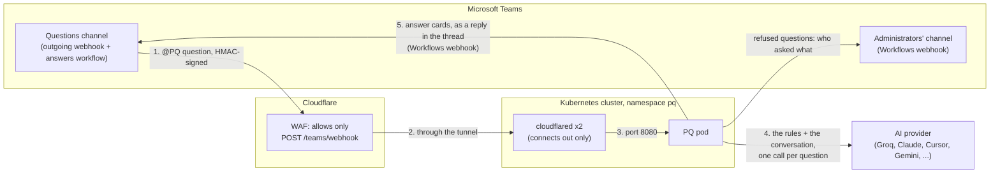
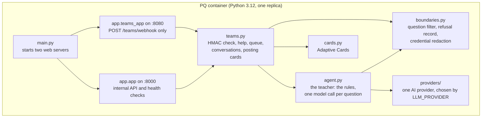
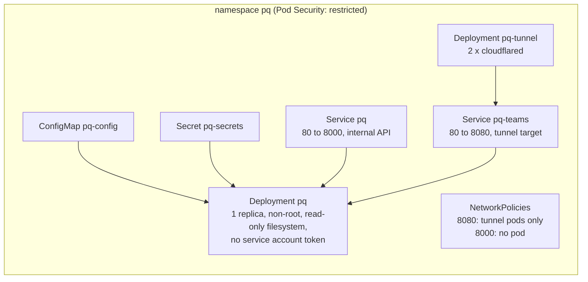
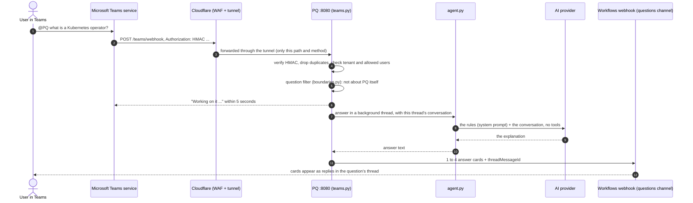
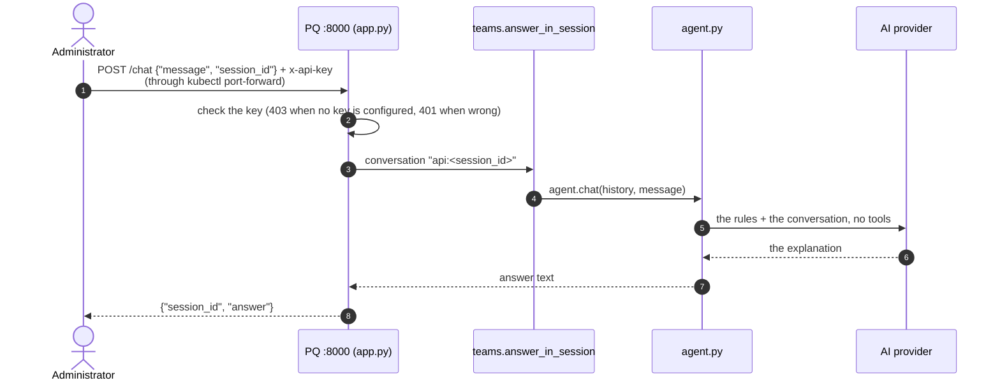
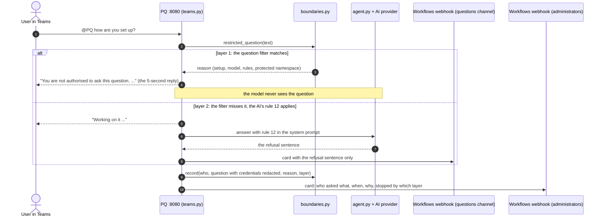
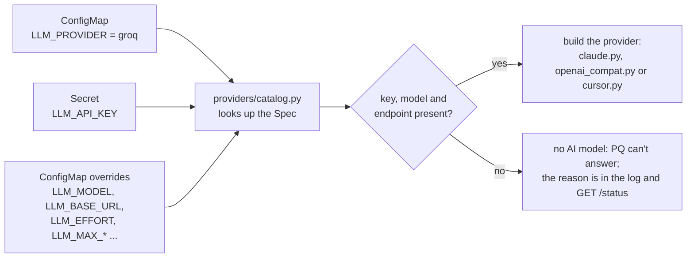
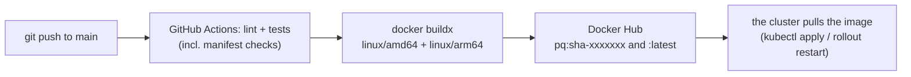

# Architecture: how PQ is built

PQ is a **technical teacher** that runs as one pod in a Kubernetes cluster and talks to people through **Microsoft Teams**. Someone mentions `@PQ` with a technical question and gets a complete explanation back in the same thread. This document explains the moving parts, how data flows between them, and why it was built this way.

- **New to the project?** Read this page first, then [CODE_WALKTHROUGH.md](CODE_WALKTHROUGH.md) for the code.
- **Installing it?** Go to [INSTALLATION.md](INSTALLATION.md).

All diagrams are [Mermaid](https://mermaid.js.org/); GitHub renders them in place.

---

## 1. What it does, in one picture



| It… | How |
|---|---|
| **Answers any technical question** | `@PQ what is a Kubernetes operator?` in a Teams channel. The answer is a full lesson: what it is, why it exists, how it works, a real-time scenario, an example, common mistakes, when to use it, takeaways and what to learn next. |
| **Fits the answer to the question** | A doubt gets a direct answer, an error gets cause and fix, a comparison gets a table, "quiz me on …" gets a quiz. |
| **Keeps the conversation** | Follow-ups in the same thread (`go deeper`, `simpler please`, `another example`, `continue`) build on what was said. |
| **Uses the AI model you choose** | One setting, `LLM_PROVIDER`, picks the provider. A provider is required: without one PQ says it can't answer. |
| **Has no tools and no access** | PQ answers from the model's knowledge. It never calls the Kubernetes API, reads no files and no systems, and has no Kubernetes permissions. |
| **Doesn't talk about itself** | Questions about PQ's own setup, AI model, rules or namespace are refused in Teams and reported to the administrators. |

---

## 2. Components

### 2.1 Inside the PQ pod



| Module | Responsibility |
|---|---|
| [`main.py`](../agent/main.py) | Entrypoint. Runs the internal API (8000) and the Teams-only app (8080). |
| [`app.py`](../agent/app.py) | FastAPI apps. `app`: internal API (`/chat`, `/status`, `/teams/test`, `/security/restricted`, probes). `teams_app`: nothing but `POST /teams/webhook`. |
| [`teams.py`](../agent/teams.py) | Everything Teams: verifies the HMAC signature, checks the tenant and the allowed users, answers `help`, acknowledges within Teams' 5-second limit, queues the question, keeps one conversation per thread, posts cards to Workflows webhooks with retries. |
| [`agent.py`](../agent/agent.py) | The teacher: the rules (system prompt), one model call per question, the conversation history and its trimming. |
| [`boundaries.py`](../agent/boundaries.py) | What may not be asked in Teams: the question filter, the flag that marks a request as coming from Teams, the record of refusals, redaction of credentials in what is kept and reported. |
| [`cards.py`](../agent/cards.py) | Builds every Adaptive Card (answer, refusal notice, test), splits a long answer over several cards and keeps each one under Teams' size limit. |
| [`providers/`](../agent/providers) | AI providers, one folder: [`catalog.py`](../agent/providers/catalog.py) lists them all; `LLM_PROVIDER` picks one. See [AI_PROVIDERS.md](AI_PROVIDERS.md). |
| [`timefmt.py`](../agent/timefmt.py) | Shows times on the administrators' cards in the `TIMEZONE` zone. |
| [`cli.py`](../agent/cli.py) | PQ from a terminal: `ask`, `chat`, `teams-test`. |

### 2.2 Kubernetes objects



| File | Creates |
|---|---|
| [`deploy/deployment.yaml`](../deploy/deployment.yaml) | Namespace, ConfigMap `pq-config`, Deployment `pq`, Services `pq` and `pq-teams`, NetworkPolicy |
| [`deploy/cloudflare-tunnel.yaml`](../deploy/cloudflare-tunnel.yaml) | Deployment `pq-tunnel` (2 × cloudflared), PodDisruptionBudget, NetworkPolicy |

**No RBAC.** There is no ServiceAccount, Role or binding in either file, and both Deployments set `automountServiceAccountToken: false`. PQ never calls the Kubernetes API. Its only outbound calls are to the AI provider and to the Teams webhooks.

The Secrets `pq-secrets` and `pq-tunnel` are created by hand with `kubectl` ([INSTALLATION.md](INSTALLATION.md), the Secret step and the Cloudflare Tunnel step), so no key is ever in Git.

---

## 3. The flows

The exact rules behind each flow (what the AI must do, how an answer reaches Teams, what is refused) are in [RULES.md](RULES.md).

### 3.1 Question from Teams



Teams waits at most **5 seconds** for an outgoing webhook's reply and an explanation takes longer, so the question is only acknowledged in that reply. The answer goes through the channel's Workflows webhook. PQ sends the question's thread (`threadMessageId`, `channelId`) with each card; the workflow's **Reply with an adaptive card in a channel** action puts it under the question ([INSTALLATION.md](INSTALLATION.md), the Teams step). A workflow that uses "Post card" instead starts a new post.

Some messages are answered directly in the 5-second reply and never reach the model: `help` (or an empty mention, `hi`, `hello`, `hey`), a message from another tenant or from someone not on the allowed-users list, a duplicate delivery, a question when no AI provider or no reply webhook is configured, and a question when 6 others are already running or waiting ("busy").

### 3.2 Question through the internal API or the CLI



The call is synchronous: the HTTP response is the answer. The CLI (`python cli.py ask "..."`, `python cli.py chat`) calls `agent.chat` directly, without the HTTP server. Neither path has the boundaries of section 3.3: the internal API needs `AGENT_API_KEY` and the CLI needs the provider key, so both are for the administrators.

### 3.3 Refusal



Every refusal is logged and kept in memory (the newest 200, `GET /security/restricted`). The card to the administrators is sent only when `TEAMS_SECURITY_WEBHOOK_URLS` is set, and at most 20 times an hour. Details: [RULES.md, section 3](RULES.md#3-boundaries-what-may-not-be-asked).

### 3.4 One answer, one model call

```mermaid
flowchart TD
    start(["question + the conversation so far"]) --> has{"LLM_PROVIDER set<br/>and configured?"}
    has -- no --> none(["'No AI model is configured ...'"])
    has -- yes --> shape{"provider shape"}
    shape -- "chat provider<br/>(Claude, Groq, Gemini, OpenAI, ...)" --> trim["trim the history:<br/>20 messages, and the characters<br/>the provider takes"]
    trim --> call["one call: create(rules, history, no tools)"]
    shape -- "agent provider<br/>(Cursor)" --> cursor["one Cursor run without tools:<br/>one message = recent transcript + new question"]
    call --> res{"result"}
    cursor --> res
    res -- "text" --> ok(["the answer; question and answer<br/>are added to the history"])
    res -- "cut at the output limit" --> cut(["the answer + 'reply continue for the rest'"])
    res -- "refused by the model, or empty" --> no(["'declined' / 'couldn't produce an answer';<br/>history unchanged"])
    res -. "API error, timeout" .-> err(["error to the caller;<br/>history unchanged"])
```

There is no loop and nothing to look up. The model gets no tool definitions, so it can only answer in text.

---

## 4. Choosing the AI provider



One image contains every provider. `LLM_PROVIDER` decides which one is used; nothing else is ever called. Details for each provider: [AI_PROVIDERS.md](AI_PROVIDERS.md).

---

## 5. Build and delivery



- [`.github/workflows/ci.yml`](../.github/workflows/ci.yml) runs flake8 and pytest on every pull request and push that touches `agent/`, `deploy/` or the workflow. On `main` it builds and pushes the image. "Run workflow" on `main` rebuilds the image without a code change, to pick up operating-system security updates.
- The image build applies the base image's pending OS security updates, removes pip after installing, and replaces a vulnerable package bundled in the Cursor SDK, so that image scans stay clean ([SECURITY.md](SECURITY.md)).
- The image ([`agent/Dockerfile`](../agent/Dockerfile)) contains every AI provider. `--build-arg WITH_CURSOR=false` leaves out the Cursor SDK, which has a proprietary licence.
- Deploys are manual and explicit: `kubectl apply` of the files in `deploy/`. There is no Helm chart and no Terraform, on purpose.

---

## 6. Design decisions

| Decision | Why | Trade-off |
|---|---|---|
| **Teams through an outgoing webhook + a Workflows webhook**, no bot | No Azure Bot Service or Entra app registration is needed. Both features are configured with clicks. | Questions only from a standard channel; the reply must come within 5 s, so the answer is a separate post through the workflow. |
| **No tools and no cluster access** | A teacher answers from knowledge. With nothing to read and no permissions there is nothing for a crafted question or pasted text to reach: no RBAC, no service account token, no Kubernetes client in the image. | PQ can't look at your systems or run your code; it says so instead of pretending. Answers are as current as the model. |
| **One model call per question** | Simple, predictable in cost and time, and the same for every provider. | A very large topic doesn't fit one answer; the person replies `continue`. |
| **Answers split over cards** | A full lesson is longer than one Adaptive Card may be (about 28 KB). Up to 4 cards of about 8,000 characters keep each one small, and code blocks stay whole. | A long answer is several posts in the thread; beyond 4 cards it is cut and says so. |
| **Cloudflare Tunnel** instead of a load balancer | The cluster opens the connection outward, so nothing in the cloud account accepts connections from the internet. Cloudflare's WAF lets only `POST /teams/webhook` through. | Questions from Teams depend on Cloudflare. |
| **Separate port 8080 for Teams** | Even with a Cloudflare mistake, the internal API can't be reached through the tunnel. | One more port and Service. |
| **Pluggable AI providers** (`providers/`) | Teams choose the provider they have keys and budget for: free (Groq, Gemini), paid (Claude, OpenAI, Cursor), or self-hosted (Ollama). | Quality, length and speed depend on the provider; free plans are slow and cut long lessons. |
| **A provider is required** | Every answer is the model's. There is nothing useful PQ could say without one. | No provider, no answers: PQ replies that no AI model is configured. |
| **One replica, state in memory** | Simple; no database. Conversations and the list of refusals live in the pod. | Both are lost on a restart; people ask again. |
| **A bounded queue** (2 answers at a time, 6 running or waiting) | A burst of questions can't pile up work or provider cost without limit. | The seventh person gets a "busy" reply and asks again later. |
| **Liveness reflects the Teams server** | `/healthz` fails when the server on 8080 died, so Kubernetes restarts the pod instead of it silently not answering. | A restart loses in-memory state. |
| **Internal API closed without a key** | Nothing in the cluster can ask questions or trigger Teams posts unless it has `AGENT_API_KEY`. | One more secret to set. |
| **Boundaries in two layers** (question filter, AI rule), **tuned for precision** | A filter alone can be reworded around, and a model's rule alone can be talked around. The filter only matches when PQ is clearly the subject, because learners say "you" and "your" for people in general and a wrong refusal reports an innocent person. | The filter misses some wordings (the AI's rule catches those); a few ordinary questions can still be refused, for example "PQ" meant as "priority queue". |
| **Manual `kubectl apply`, no Helm or Terraform** | Easy to read, review and change. | Values are edited in the YAML files. |

Known limitations are listed in [OPERATIONS.md](OPERATIONS.md).
