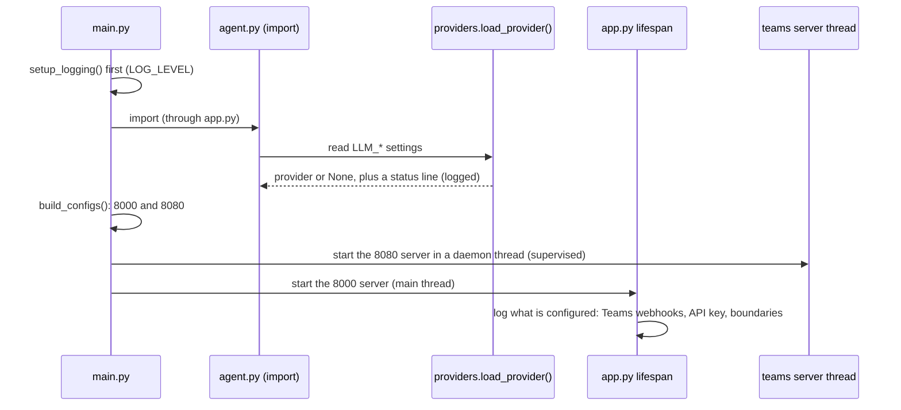

# Code walkthrough: how PQ is put together

For developers who will maintain or extend PQ. Read [ARCHITECTURE.md](ARCHITECTURE.md) first for the big picture; this page follows the code.

---

## 1. Repository map

```text
Agent-Learner/
├── agent/                          The application (Python 3.12)
│   ├── main.py                     Entrypoint: internal API :8000, Teams webhook :8080
│   ├── app.py                      FastAPI apps: app (internal API) and teams_app (POST /teams/webhook only)
│   ├── teams.py                    Teams: HMAC check, help, queue, conversations per thread, posting cards
│   ├── agent.py                    The teacher: the rules (system prompt), one model call per question, history
│   ├── boundaries.py               What may not be asked: question filter, restricted flag, refusal record, redaction
│   ├── cards.py                    Adaptive Cards: answer (split over several), refusal notice, test
│   ├── timefmt.py                  Times in the TIMEZONE zone
│   ├── cli.py                      PQ from a terminal: ask, chat, teams-test
│   ├── providers/                  AI providers (LLM_PROVIDER picks one)
│   │   ├── catalog.py              Every provider: endpoint, key variable, default model, limits; load_provider()
│   │   ├── base.py                 ChatProvider / AgentProvider shapes, Limits
│   │   ├── claude.py               Anthropic Claude
│   │   ├── openai_compat.py        Groq, Gemini, OpenAI, Azure OpenAI, OpenRouter, Mistral, Ollama, custom
│   │   └── cursor.py               Cursor (Cursor SDK)
│   ├── tests/                      pytest suite: no AI provider or Teams needed
│   ├── Dockerfile, .dockerignore
│   ├── docker/patch_cursor_bridge.py   Image build step: replaces the Cursor SDK's vulnerable undici
│   └── requirements.txt, requirements-cursor.txt, requirements-dev.txt
├── deploy/
│   ├── deployment.yaml             Namespace, ConfigMap, Deployment, Services, NetworkPolicy (no RBAC)
│   └── cloudflare-tunnel.yaml      Cloudflare Tunnel (questions from Teams)
├── .github/workflows/ci.yml        Lint + tests; on main: build and push the image
└── docs/                           All documentation (this file, INSTALLATION.md, RULES.md, …)
```

---

## 2. Start-up sequence



- **Settings** are environment variables, read once at import (`os.getenv` in each module; the AI settings in `providers/catalog.py`). Change the ConfigMap or Secret, then restart the pod.
- **State** lives in memory: conversations (`teams._sessions`), message IDs already seen (`teams._seen_ids`), refused questions (`boundaries._events`). All of it is lost on a restart.
- **Supervision:** if the 8080 server stops (port in use, crash), `main.record_failure` writes it into `app.SERVER_FAILURES`; `/healthz` then answers 503 and Kubernetes restarts the pod.
- **Logging:** loggers are named `pq.*` (`pq.main`, `pq.app`, `pq.teams`, `pq.agent`, `pq.boundaries`, `pq.llm`, `pq.time`). Probe requests are kept out of the access log.

---

## 3. Path of a question from Teams

| Step | Code | What happens |
|---|---|---|
| 1 | [`app.teams_webhook`](../agent/app.py) | Registered on both `teams_app` (8080) and `app` (8000). Returns 404 when `TEAMS_OUTGOING_WEBHOOK_SECRET` is not set. |
| 2 | [`teams.verify_hmac`](../agent/teams.py) | HMAC-SHA256 of the raw body with the base64 security token, compared in constant time; 401 when wrong. A body that is not JSON gets 400. |
| 3 | `teams.handle_outgoing` | Runs in a thread pool (`run_in_threadpool`). Ignores duplicates (Teams retries), checks `TEAMS_TENANT_ID` and `TEAMS_ALLOWED_USER_IDS`. |
| 4 | `teams.strip_mentions`, `teams.thread_of` | Turns Teams' HTML into text (the `<at>` mention is removed, line breaks are kept for pasted code). Finds the thread: `threadMessageId` and `channelId`. |
| 5 | `teams.HELP` | An empty text, `help`, `help?`, `hi`, `hello` or `hey` is answered with the help text. |
| 6 | [`boundaries.restricted_question`](../agent/boundaries.py) | A question about PQ itself is answered with `boundaries.REFUSAL` at once; `teams.report_restricted` records it and posts `cards.restricted_card` to the administrators. Nothing else runs. |
| 7 | `handle_outgoing` | Without an AI provider or without a reply webhook: a short reply saying so. |
| 8 | `teams._submit` | Queues `answer_in_session` on `_pool` (2 workers). `_slots` allows 6 running or waiting; beyond that `_submit` returns `None` and the person gets the "busy" reply. Otherwise the HTTP reply is "Working on it - …". |
| 9 | `teams._as_teams_user` → `teams.answer_in_session` | Runs on the worker inside `boundaries.restricted_access()`, so `agent._system()` adds rule 12. `session_for(conv_id)` returns the thread's history and its lock. |
| 10 | [`agent.chat`](../agent/agent.py) | The answer (section 4). |
| 11 | `teams._deliver_later` | When the future is done: if the answer contains the refusal sentence (`boundaries.is_refusal`), only that sentence is shown and the refusal is reported with "AI rule". An exception becomes the generic failure text. |
| 12 | [`cards.answer_cards`](../agent/cards.py), then `teams.post_card` | `tidy_answer`, `split_answer`, one Adaptive Card per part (at most 4). Each is posted to `TEAMS_REPLY_WEBHOOK_URL` together with the thread, with up to 3 attempts (honours `Retry-After`). URLs are never logged, only their names. |

Conversation memory: `teams._sessions` is an `OrderedDict` with one entry per Teams conversation ID (one per thread), each `{"messages", "lock", "used"}`. Entries idle for `SESSION_IDLE_SECONDS` (24 h) are removed and at most `MAX_SESSIONS` (200) are kept. `POST /chat` uses the same store with the key `api:<session_id>`.

The restricted flag is a `ContextVar`. Context variables don't follow work into another thread, which is why `_as_teams_user` enters `restricted_access()` on the worker thread itself and not in `handle_outgoing`.

---

## 4. The teacher (`agent.py` + `providers/`)

**Input:** the conversation so far (`messages`, updated in place) and the new question.

**Output:** the answer as Markdown text.

| Piece | Where | Notes |
|---|---|---|
| Provider choice | `providers.load_provider()`, at import | `agent.llm` is the provider (or `None`); `agent.LLM_STATUS` is the one-line explanation shown in `GET /status`. |
| The rules | `agent.SYSTEM` | The role, rules 1 to 11 and one worked example. `ANSWER_MAX_WORDS` is built into rule 10 (`_LENGTH_RULE`). Documented in [RULES.md, section 1](RULES.md#1-the-ais-rules); keep both in step. |
| Rule 12 | `agent.BOUNDARY_RULE`, `agent.SYSTEM_RESTRICTED`, `agent._system()` | Inserted after rule 11, before the example. `_system()` returns it only while `boundaries.is_restricted()` is true, which is for requests from Teams. |
| Entry point | `agent.chat(messages, user_text)` | Returns `NO_MODEL` without a provider. Otherwise `_chat` or `_agent_chat`, by `llm.kind`. |
| Chat providers | `agent._chat` | Appends the question, trims the history, makes one call `llm.create(_system(), messages, [])`. Refusal or empty answer: the question is removed again and `DECLINED` / `NO_ANSWER` is returned. `max_tokens`: the answer plus `CUT_OFF`. An exception also removes the question and is raised to the caller. |
| Agent providers | `agent._agent_chat` | Builds one prompt from `_transcript(messages)` (the last 6 messages as "User:" / "PQ:" lines) and the new question, opens `llm.session(_system(), [], …)` and sends it. An empty answer returns `NO_ANSWER` and leaves the history alone. |
| History trimming | `agent.trim_history(messages, keep=20, max_chars)` | Keeps about 20 messages and, when `max_chars` is set, that much text. The cut lands on a user turn; the newest question always stays; thinking blocks are removed from what is kept, because their signature covers history that was just cut away. |
| Request budget | `agent._history_budget()` | `limits.request_chars` minus the length of the system prompt minus 500, at least 2,000. `0` (no limit) when the provider has no request limit. |
| Fixed messages | `NO_MODEL`, `NO_ANSWER`, `DECLINED`, `CUT_OFF` | The texts a person sees when there is no model answer to show. |

**No tools.** `agent.py` passes an empty tool list to every provider. The provider classes can still carry tool definitions and tool calls (`ChatProvider.create(system, messages, tools, require_tool)`, `AgentProvider.session(system, tools, execute)`), and their tests still cover that. PQ just passes none.

**Canonical history format.** Conversations are stored in the Anthropic Messages shape (a user turn is a string; an assistant turn is the list of content blocks the provider returned). `openai_compat.to_openai_messages` converts it for OpenAI-compatible APIs on every call, so one code path serves every chat provider.

---

## 5. Boundaries (`boundaries.py`)

| Piece | Where | Notes |
|---|---|---|
| Switches | `ENABLED`, `PROTECTED_NAMESPACES` | From `BOUNDARIES_ENABLED` and `PROTECTED_NAMESPACES` (default `pq`; `none` = no namespace). |
| The refusal | `REFUSAL`, `_REFUSAL_MARK`, `is_refusal` | The fixed sentence, and the pattern that recognises it in a model's answer (layer 2). |
| The restricted flag | `restricted_access()`, `is_restricted()` | A context manager around a `ContextVar`. `agent._system()` reads it. |
| Layer 1 | `_CHECKS`, `restricted_question(text)` | Lists of compiled patterns per reason, checked in this order: rules, model, protected namespace, setup. Returns the reason or `None`. The building blocks (`_SELF`, `_NAMED`, `_YOUR`, `_PART`, `_BUILT`, `_STOP`, …) keep PQ as the subject of each pattern; the comment above them explains the precision rule. |
| Redaction | `redact(text)` | Hides `key=value` credentials, passwords in URLs, AWS access key IDs and JWTs. Applied to a refused question before it is kept, logged or sent. |
| The record | `record(...)`, `recent(limit)` | A deque of the newest `MAX_EVENTS` (200) refusals, and the card limit of `MAX_CARDS_PER_HOUR` (20). `record` logs the refusal and says whether a card may still be sent. |

The rules and the examples are in [RULES.md, section 3](RULES.md#3-boundaries-what-may-not-be-asked).

---

## 6. The internal API and the CLI

| Endpoint | Code | Notes |
|---|---|---|
| `GET /healthz`, `GET /ready` | `app.healthz`, `app.ready` | No key. `/healthz` is 503 when the Teams server died. |
| `POST /chat` | `app.chat` | `ChatIn`: `message`, optional `session_id` (a new UUID when missing). Calls `teams.answer_in_session("api:<sid>", message)` directly: no queue, no boundaries. |
| `GET /status` | `app.status` | Teams targets by name, the AI provider (`llm.describe()` and `LLM_STATUS`), the boundaries. |
| `POST /teams/test` | `app.teams_test` | `teams.post_test()` posts `cards.test_card()` to the reply webhook; 400 without one. |
| `GET /security/restricted` | `app.security_restricted` | `boundaries.recent(limit)`, `limit` between 1 and 200. |

`app.auth` guards every endpoint except the probes: 403 when `AGENT_API_KEY` is not set, 401 when the `x-api-key` header is missing or wrong (constant-time comparison). `teams_app` has none of these routes and no `/docs`.

[`cli.py`](../agent/cli.py) calls `agent.chat` directly (`ask`: an empty history; `chat`: one history for the session) and `teams.post_test()` (`teams-test`).

---

## 7. Tests

`pytest tests -q` in `agent/` runs everything without an AI provider or Teams: [`tests/conftest.py`](../agent/tests/conftest.py) clears the provider settings, sets fake Teams webhooks and offers `fake_llm`, a stand-in provider. HTTP calls and SDKs are replaced with fakes.

| File | Covers |
|---|---|
| `test_agent.py` | The rules (the nine parts, the length setting), one call without tools per question, follow-ups, the cut-off line, declined and empty answers, provider errors, no provider, history trimming |
| `test_teams.py` | HMAC, mention stripping, help, tenant and user checks, duplicates, the acknowledgement and the later answer, several cards in the thread, conversations per thread, bounded sessions, the busy reply, posting with retries, URLs never logged |
| `test_cards.py` | The Workflows envelope, the size guard, `tidy_answer`, splitting between paragraphs and around code blocks, the cap of 4 cards, the test card |
| `test_boundaries.py` | Questions that must be refused (per reason) and questions that must pass; rule 12 only for Teams (both provider shapes); the administrators' card, its rate limit and redaction; no provider or model name in cards; `/security/restricted` |
| `test_app.py` | Health checks, the webhook's signature check, `/chat` sessions, `/status`, `/teams/test`, the API key, the closed internal API, the Teams-only app on 8080, supervised servers |
| `test_provider_catalog.py` | Every provider in the catalog: defaults, required settings, keys, aliases, overrides, effort |
| `test_provider_openai_compat.py` | History conversion, request budget, tool calls, retries, rate limits, Azure header, a full and a cut-off Groq answer |
| `test_provider_claude.py` | The request sent to the Anthropic API, with and without tools |
| `test_provider_cursor.py` | Cursor with a fake SDK: tool groups, tool callbacks, failed and slow runs, PQ's run without any tools, the transcript in follow-ups |
| `test_image_build.py` | The undici patch (replacement, checksum, refusal on unknown importers, safe unpacking) and what the Dockerfile must keep doing (OS updates, no pip, no build helpers) |
| `test_manifests.py` | `deploy/*.yaml`: names, no Kubernetes permissions at all, settings that exist in code, no keys in the ConfigMap, Services, network policies, tunnel hardening; nothing of the removed features is left |

CI ([`.github/workflows/ci.yml`](../.github/workflows/ci.yml)) runs `flake8 --select=E9,F63,F7,F82,F401,F841` and `pytest` on every pull request and push, and builds the image on `main`.

---

## 8. Extending it

| You want to… | Do this |
|---|---|
| **Change how PQ teaches** | Edit `SYSTEM` in `agent.py`, update [RULES.md, section 1](RULES.md#1-the-ais-rules), and adjust `test_rules_make_pq_a_teacher` in `test_agent.py`. Every character of the prompt is sent with every question, and on a free plan it uses up request size. |
| **Add an AI provider** | See [AI_PROVIDERS.md, section 7](AI_PROVIDERS.md#7-adding-a-provider). |
| **Give the model tools again** | The interface is still there. Chat providers: pass tool definitions (Anthropic style: `name`, `description`, `input_schema`) as the third argument of `llm.create`, and loop while the reply's `stop_reason` is `tool_use`, sending `tool_result` blocks back. Cursor: pass the definitions and an `execute(name, args)` function to `llm.session`. `LLM_MAX_STEPS` and `LLM_TOOL_OUTPUT_CHARS` (`limits.steps`, `limits.tool_chars`) are there for such a loop. Rule 6 says the model has no tools, and the boundaries assume there is nothing to read: change both, and [SECURITY.md](SECURITY.md), before you do. |
| **Add a fixed Teams reply** (like `help`) | Handle it in `teams.handle_outgoing` before the question filter, mention it in `HELP`, and add a test in `test_teams.py`. |
| **Refuse another kind of question** | Add a pattern to `_CHECKS` in `boundaries.py` (keep PQ as the subject of the pattern), and add the wording to the "must be refused" list and a look-alike technical question to the "must pass" list in `test_boundaries.py`. Document it in [RULES.md, section 3](RULES.md#3-boundaries-what-may-not-be-asked). |
| **Change the card layout or sizes** | `PART_CHARS`, `MAX_PARTS` and `answer_cards` in `cards.py`; tests in `test_cards.py`. Keep `PART_CHARS` well under `MAX_CARD_BYTES`. |
| **Add a setting** | Read it with `os.getenv` (AI settings: in `providers/catalog.py`), add it to the ConfigMap with a comment, and to [CONFIGURATION_REFERENCE.md](CONFIGURATION_REFERENCE.md). `test_manifests.py` fails if the ConfigMap has a key the code never reads. |

---

## 9. Local development

```bash
cd agent
python -m venv .venv && source .venv/bin/activate      # Windows: .venv\Scripts\Activate.ps1
pip install -r requirements-dev.txt                     # add -r requirements-cursor.txt to try Cursor
pytest tests -q                                         # no AI provider or Teams needed
flake8 . --select=E9,F63,F7,F82,F401,F841
```

Run it on your machine. No cluster is needed:

```bash
export LLM_PROVIDER=groq LLM_API_KEY=gsk_...            # any provider from docs/AI_PROVIDERS.md
python cli.py ask "what is a Kubernetes operator?"      # one question, one answer
python cli.py chat                                      # a conversation

export AGENT_API_KEY=dev                                # the internal API is off without a key
export TEAMS_REPLY_WEBHOOK_URL='https://...'            # optional: real cards to Teams
python main.py                                          # API on http://localhost:8080/docs, Teams webhook on :8080
python cli.py teams-test                                # a test card to TEAMS_REPLY_WEBHOOK_URL
```

On Windows, installing `cursor-sdk` may fail on long file paths; enable Windows long-path support or use WSL.

Build the image yourself (CI normally does it):

```bash
docker build -t pq agent                                   # every AI provider
docker build --build-arg WITH_CURSOR=false -t pq agent     # without the Cursor SDK
```
