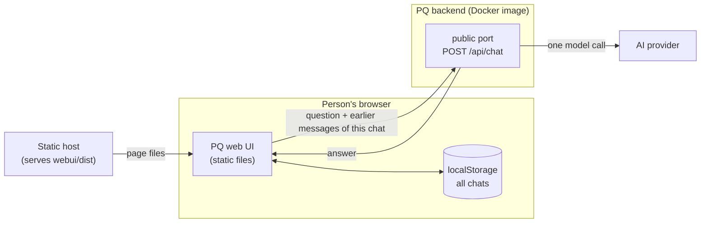

# Web UI: chat with PQ in a browser

A chat page in the style of ChatGPT or Copilot, in [`webui/`](../webui). It is a static site (HTML, CSS and JavaScript, no framework and no third-party script) that you host anywhere and point at the PQ backend.

- **Chats are stored on the person's device only**, in the browser's `localStorage`. The backend keeps nothing.
- **The chat's memory is the device's memory.** With every question the page sends the earlier messages of that chat, read from the device. That is how "go deeper" or "continue" works. A chat that is deleted on the device is gone everywhere.
- The same rules apply as in Teams: the teaching rules ([RULES.md](RULES.md), section 1) and the boundaries (section 3).



---

## 1. The two settings that connect them

| Where | Variable | Value |
|---|---|---|
| Backend (the Docker service) | `WEB_UI` | The UI's address, e.g. `https://pq-ui.onrender.com`. Several: comma separated. No path, no trailing slash needed. |
| UI (the static site) | `BACKEND_URL` | The backend's address, e.g. `https://pq.onrender.com`. Read when the site is built. |

Until `WEB_UI` is set, the backend's chat API answers 404. `WEB_UI` is what lets the browser call the backend from the UI's address (CORS).

Optional, on the backend:

| Variable | Default | Meaning |
|---|---|---|
| `WEB_ACCESS_CODE` | not set | A shared code. When set, the UI asks for it once (Settings, **Access code**), keeps it on the device and sends it with each question. **Recommended**: without it, anyone who finds the backend's address can ask questions at your AI provider's cost. |
| `WEB_RATE_PER_MINUTE` | `20` | Questions one address may ask per minute. |

---

## 2. Deploy on Render

### 2.1 With the blueprint

[`render.yaml`](../render.yaml) describes both services.

1. Push this repository to GitHub.
2. In Render: **New** > **Blueprint**, choose the repository.
3. Render asks for the values it can't know:
   - `LLM_PROVIDER` and `LLM_API_KEY` ([AI_PROVIDERS.md](AI_PROVIDERS.md))
   - `WEB_ACCESS_CODE`: choose a code (recommended)
   - `WEB_UI` and `BACKEND_URL`: leave empty for now
4. After the first deploy Render shows each service's address. Set them:
   - service **pq** > Environment > `WEB_UI` = the address of **pq-ui**
   - service **pq-ui** > Environment > `BACKEND_URL` = the address of **pq**
5. Redeploy both (**Manual Deploy**). The UI must be rebuilt because `BACKEND_URL` is read at build time.

### 2.2 By hand

**Backend** (New > Web Service):

| Setting | Value |
|---|---|
| Runtime | Docker |
| Root Directory | `agent` |
| Health Check Path | `/api/health` |
| Environment | `LLM_PROVIDER`, `LLM_API_KEY`, `WEB_UI`, `WEB_ACCESS_CODE`, `PROTECTED_NAMESPACES=none` |

Render sets `PORT`; PQ puts its public port there. Only that port is reachable: the internal API on 8000 is not exposed.

**UI** (New > Static Site):

| Setting | Value |
|---|---|
| Root Directory | `webui` |
| Build Command | `npm run build` |
| Publish Directory | `dist` |
| Environment | `BACKEND_URL` |

### 2.3 Check

```bash
curl -s https://<backend>/api/health
# {"status":"ok","service":"pq","web_ui":true,"access_code_required":true}
```

`"web_ui": false` means `WEB_UI` is not set on the backend. Then open the UI's address and ask a question.

---

## 3. Other hosts for the UI

Any static host works (Netlify, Vercel, Cloudflare Pages, GitHub Pages, an S3 bucket, nginx). Build with `BACKEND_URL` set and publish `webui/dist`:

```bash
cd webui
BACKEND_URL=https://your-backend.example.com npm run build
```

The build needs Node.js 18 or newer and no packages. It copies the files to `dist/` and writes `dist/config.js` with the backend's address.

A host without a build step can serve the `webui/` folder as it is: edit `BACKEND_URL` in [`webui/config.js`](../webui/config.js), or leave it empty and let each person enter the address under Settings, **Backend URL**.

---

## 4. Using it

| | |
|---|---|
| **Ask** | Type a question, Enter sends, Shift+Enter starts a new line. The round button becomes **Stop** while PQ writes. |
| **Follow up** | Ask in the same chat. The last 30 messages of the chat go along with the question. |
| **Chats** | The sidebar lists them by date, with search, rename and delete. **New chat** starts without any earlier context. |
| **Answers** | Rendered as Markdown: headings, lists, tables, code blocks with a **Copy** button. |
| **Settings** | Theme, access code, backend URL, and export, import or delete of all chats. |
| **Move to another device** | Settings > **Export** on the old device, **Import** on the new one. There is no account and no sync. |

What ends a chat's memory: deleting the chat, clearing the browser's site data, a private window being closed, or using another browser or device.

---

## 5. Run it locally

```bash
# terminal 1: the backend, with the UI's local address allowed
cd agent
WEB_UI=http://localhost:5173 LLM_PROVIDER=groq LLM_API_KEY=... python main.py     # public port 8080

# terminal 2: the UI
cd webui
BACKEND_URL=http://localhost:8080 npm start                                      # http://localhost:5173
```

---

## 6. What to know about privacy and safety

- **On the device:** all chats, the access code and the settings, in `localStorage` of the UI's address. Anyone who can use that browser profile can read them. Nothing is encrypted.
- **Sent to the backend:** the question and the earlier messages of that chat, and the access code. The backend passes the conversation to the AI provider and returns the answer. It writes no conversation to disk and keeps none in memory after the answer.
- **Logged by the backend:** the length of a question, never its text. The exception is a refused question about PQ itself: its text (credentials redacted) and the caller's address are kept and reported like in Teams.
- **`WEB_UI` is not a login.** It stops other websites from calling your backend from a browser. A script can still call it, which is why `WEB_ACCESS_CODE` and the rate limit exist. The access code is one shared code, not per person: change it to lock everyone out.
- **Answers can't inject code.** The page escapes all text before formatting it and only makes `http`, `https` and `mailto` links clickable.
- **The conversation comes from the device**, so a person can send any history they like. That only affects their own answer.

---

## 7. Troubleshooting

| Symptom | Cause and fix |
|---|---|
| "Can't reach PQ at ..." | Wrong `BACKEND_URL` (rebuild the UI after changing it), the backend is down, or a free Render service is asleep and needs up to a minute for the first request. |
| The browser console shows a CORS error | `WEB_UI` on the backend doesn't match the UI's address exactly (scheme and host, e.g. `https://pq-ui.onrender.com`). Redeploy the backend after changing it. |
| "This PQ needs an access code." | Enter the code under Settings, **Access code**. |
| "No AI model is configured ..." | `LLM_PROVIDER` or its key is missing on the backend. |
| "Too many questions in a minute." | The rate limit. Wait, or raise `WEB_RATE_PER_MINUTE`. |
| The answer stops in the middle and says to reply `continue` | The provider's reply limit. Raise `LLM_MAX_OUTPUT_TOKENS` ([AI_PROVIDERS.md](AI_PROVIDERS.md)). |
| Chats are gone | They lived in that browser only: site data was cleared, or it is another browser, profile or device. |
| "This browser's storage is full or blocked" | Delete old chats under Settings, or allow site data for the UI's address. |
